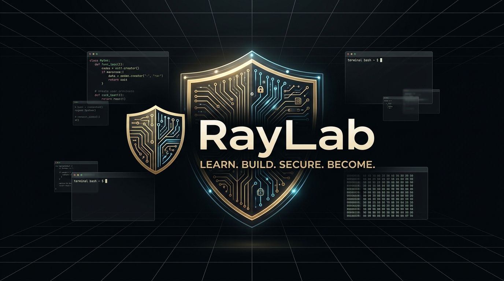

<div align="center">
  
</div>

# 🛡️ RayLab — Learn. Build. Secure. Become.

> Plateforme personnelle et éducative consacrée à l'apprentissage de l'informatique, de la programmation Python, des systèmes Linux, des réseaux et de la cybersécurité opérationnelle.

---

## 🌟 Présentation

Conforme au **Cahier des charges RayLab v2.0** et au schéma de données **Turso / libSQL (SQLite-compatible) v1.0** :

1. **Usage Personnel (Fondateur) :** Environnement structuré pour suivre ses objectifs privés, préparer des certifications réelles (CompTIA Security+, CCNA, LPIC-1) et documenter ses projets.
2. **Usage Public (Apprenants) :** Parcours pédagogiques progressifs du fondamental au niveau professionnel, exercices interactifs, évaluations et générateur de CV ATS.
3. **Laboratoire Virtuel (WASM & Linux) :** Assistant technique interactif intégré, compatible avec les modèles IA gratuits via **Omniroute**, **Opencode**, ou moteur local autonome.

---

## 🎨 Charte Graphique & Direction Artistique

- **Obsidian :** `#101216` (Arrière-plan sombre et immersif)
- **Graphite :** `#20252C` (Surfaces de cartes, barres d'outils et bordures)
- **Ivory :** `#F3F0E8` (Typographie claire et contrastée)
- **Gold :** `#C6A66B` (Accents précieux, jalons, séries et badges)
- **Couleurs Fonctionnelles :** Vert (succès), Rouge (alertes sécurité), Orange (statuts), Bleu (réseaux & CLI)

---

## 🚀 Fonctionnalités Clés Implémentées

| Section | Description |
|---|---|
| **Accueil & Présentation** (`/`) | Présentation des 4 piliers (*Learn, Practice, Build, Become*), vitrine des projets et des parcours. |
| **Académies & Parcours** (`/paths`) | Programming Academy (Python 1 à 7), Cybersecurity Academy (Blue Team SOC), Systems & Networks, Career Launchpad. |
| **Curriculum Détaillé** (`/paths/[slug]`) | Découpage en cours, modules ordonnés et leçons avec prérequis et estimation horaire. |
| **Lecteur de Leçon** (`/lessons/[id]`) | Support Markdown enrichi, navigation précédente/suivante, validation de complétion avec confettis et gain d'XP. |
| **Simulateur d'Exercices** | Éditeur de code intégré, exécution interactive et validation de code (ex: filtrage de ports sécurisés). |
| **Moteur d'Évaluation / Quiz** | Questions à choix multiples évaluées côté serveur (clé de réponse protégée), calcul du score et feedback explicite. |
| **Hub Projets** (`/projects` & `/[slug]`) | Cahier des charges pour Password Strength Checker, SOC Log Analyzer, File Integrity Monitor (FIM). |
| **Espace Portfolio** | Formulaire de soumission de projets avec lien GitHub, documentation, démo en ligne et visibilité publique/privée. |
| **Générateur de CV ATS** (`/career/cv-builder`) | Formulaire en ligne avec diagnostic ATS en direct, respect de la formule Google XYZ, format compatible France/UE et Allemagne (*Lebenslauf*), export / impression PDF. |
| **Roadmaps Métiers** (`/career`) | Fiches détaillées : Junior SOC Analyst, Python Developer & Automation Engineer. |
| **Catalogue Certifications** (`/certifications`) | Référentiel des certifications officielles vérifiées (CompTIA Security+, CCNA, LPIC-1). |
| **Tableau de Bord** (`/dashboard`) | Bascule en 1 clic entre le **Personal Mode (Fondateur)** et le **Public Mode**, suivi des objectifs privés, calcul de streak et badges. |
| **Console d'Administration** (`/admin`) | Supervision des utilisateurs, statistiques globales et studio de contenu. |
| **Laboratoire Virtuel (WASM & Linux)** | Tiroir d'assistance IA avec prompts rapides, suggestions de correction et support Opencode / Omniroute. |

---

## 🛠️ Stack Technique

- **Framework :** [Next.js 15](https://nextjs.org/) (App Router, Server & Client Components, React 19)
- **Base de données :** [Turso](https://turso.tech/) / [libSQL](https://github.com/tursodatabase/libsql) & SQLite natif Node.js
- **Style :** [Tailwind CSS](https://tailwindcss.com/) avec palette sur-mesure RayLab
- **Typographie :** Inter / JetBrains Mono
- **Icônes :** Lucide React

---

## 📦 Installation & Démarrage

```bash
# Se placer dans le répertoire du projet
cd "C:\Users\raysn\.gemini\antigravity\scratch\rayan-lab"

# Réinstaller les dépendances si nécessaire
pnpm install

# Réinitialiser / Seeder la base SQLite avec le schéma Turso v1.0
node scripts/seed.mjs

# Lancer le serveur de développement
pnpm dev

# Ou lancer en mode production
pnpm build
pnpm start -p 3000
```

L'application est immédiatement accessible sur [http://localhost:3000](http://localhost:3000).
